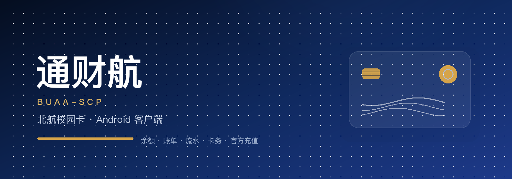
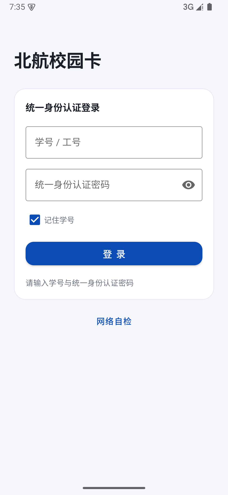
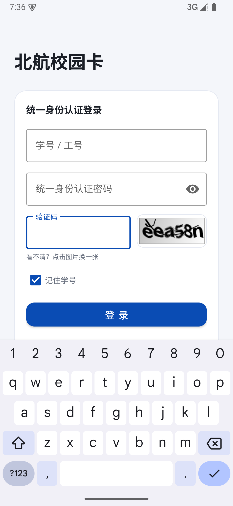

<p align="center">
  
</p>

<h1 align="center">通财航</h1>

<p align="center">
  北航校园卡便携客户端 · 用统一身份认证直接查看余额、账单、流水与卡务
</p>

<p align="center">
  
  
  
  
</p>

> **通财航**（工程名 `Buaa-SCP`，包名 `cn.edu.buaa.scp`）是一个非官方 Android 客户端。
> 不依赖微信 / 企业微信，不保存密码；充值时把当前会话带进**学校官方充值页**，支付仍由校方平台完成。

---

## 功能

| 模块 | 能力 | 数据来源 |
|---|---|---|
| 登录 / 会话 | 统一身份认证账号密码登录；`CASTGC` 免密续期；启动自动恢复；图形验证码 | `sso.buaa.edu.cn` |
| 首页 | 余额、卡状态、姓名、学号、卡类型、消息通知、支付渠道 | `openHomePageApp` / `openCardPay` |
| 账单 | 当月分类消费与占比、近半年按月汇总、近半年支出趋势 | `queryUserMonthlybill` / `queryRechargeGroupByMonth` / `queryUserMonthlybillHalfOfYear` |
| 流水 | 按月份 + 类型（全部 / 消费 / 充值 / 补助 / 转账）分页查询 | `queryCardSelfTradeList` |
| 卡务 | 卡号、姓名、状态、余额、支付渠道 | `openCardReportLoss` / `openCardPay` |
| 充值 | 打开**学校官方充值页**，选金额与支付方式；预置 `JSESSIONID` 与 `CASTGC` | `m.icw.buaa.edu.cn/card` 官方页面 |
| 设置 | 账号、会话状态、网络自检、续期、退出；运行日志默认隐藏 | 本地 + 自检探针 |

客户端只做三件事：**认证、读取、把会话带进官方页面**。不读取或保存校园卡密码，不调用充值下单接口，
不保存银行卡或订单信息，也不提供挂失提交、补卡、限额修改等写操作。

## 截图

| 登录 | 图形验证码 |
|---|---|
|  |  |

> 数据页截图包含姓名、学号、卡号与消费记录，公开仓库中不放原图。

## 安装

### 从 Releases 下载

到 [Releases](https://github.com/y38501148-max/Buaa-SCP/releases) 下载最新的
`TongCaiHang-v*-release.apk`，传到手机安装。首次安装需在系统设置中允许该来源。

### 通过 USB 安装

```bash
./install.sh                 # 自动选择 dist/ 下的 release APK
./install.sh path/to.apk     # 指定 APK
```

脚本会优先选择 `dist/` 中版本号最高的 `TongCaiHang-*-release.apk`，安装后自动启动。

> debug 与 release 使用不同签名，不能互相覆盖。切换签名时需要先
> `adb uninstall cn.edu.buaa.scp`，本机会话会被清除，需要重新登录。

## 从源码构建

环境：JDK 17/21、Android SDK Platform 35、Build-Tools 35.0.0。

```bash
echo "sdk.dir=$HOME/Library/Android/sdk" > local.properties
./gradlew :app:assembleDebug
./gradlew :app:testDebugUnitTest
```

debug APK 位于 `app/build/outputs/apk/debug/app-debug.apk`。
debug 构建会把接口原始响应写入应用私有目录 `files/debug/`，release 不落盘。

### 构建签名的 release

仓库**不包含**签名材料。首次构建 release 时生成一套自己的 keystore：

```bash
mkdir -p keystore
keytool -genkeypair -v \
  -keystore keystore/buaa-scp-release.jks \
  -alias buaa-scp \
  -keyalg RSA -keysize 4096 -validity 10000 \
  -dname "CN=Buaa-SCP, OU=Personal, O=Buaa-SCP, L=Beijing, ST=Beijing, C=CN"

cat > keystore.properties <<EOF
storeFile=keystore/buaa-scp-release.jks
storePassword=<你的密码>
keyAlias=buaa-scp
keyPassword=<你的密码>
EOF

./gradlew :app:assembleRelease
```

产物：`app/build/outputs/apk/release/app-release.apk`。R8 开启，release 包约 1.3 MB。

## 使用

1. 首次启动输入学号与统一身份认证密码；登录成功后 `CASTGC` 会加密保存在本机。
2. 之后启动会先用本地会话，失效时自动用 `CASTGC` 续期；两者都失效才需要重新登录。
3. 首页「去充值」、卡务页「校园卡充值」会打开学校官方充值页；航财通等后续页面复用预置的
   `CASTGC` 静默完成统一认证。
4. 运行日志默认隐藏：设置 → 连点「版本」7 次。

## 认证链路

```
学号 + 统一身份认证密码
   │ ① GET  CAS 登录页，解析 execution；若出现 config.captcha 则拉取图片验证码
   ▼
POST sso.buaa.edu.cn/login  → 302 + CASTGC
   │ ② 回调地址里的 openid 位置必须填哨兵值 112233
   ▼
GET /card/home/sisUstbMiniReturnPage/112233/6/auth?ticket=ST-…
   │ ③ 服务端用 CAS 学号反查真实 openid → 302 goIndex?openid=…
   ▼
JSESSIONID（业务会话）
   │ ④ 业务接口只带该 Cookie，绝不再附加 openid
   ▼
余额 / 账单 / 流水 / 卡务 / 官方充值页
```

三个关键点（实测复现）：

1. 回调路径中的 openid 位置是**哨兵值 `112233`**，填真实 openid 会得到「用户信息不匹配」；
2. CAS 票据一次性，业务接口只认 `JSESSIONID`；
3. 业务请求携带 `openid` 可能触发 401；本项目按此实现（个别接口按官方前端行为例外处理）。

响应可能是明文 JSON，也可能是 `{"datajson": ...}` 的 AES-128-ECB 密文：
`datajson` 前 16 字符为密钥素材，`handleKey = reverse 后（后 6 位 + 前 6 位）`。

验证码细节见 [`docs/CAPTCHA.md`](docs/CAPTCHA.md)。

## 充值

充值接口、支付方式编码与「为什么不做原生支付」的完整分析见 [`docs/RECHARGE.md`](docs/RECHARGE.md)。

一句话结论：`/card/wxpay/*`、`/alipay/*`、`/ccbpay/*`、`/bankcard/rechargeCard`、
`/recharge/rechargeByHct` 都存在，但第三方支付需要 JSSDK / 表单 / App 跳转，银校转账还要
6 位校园卡密码。客户端的最优解是**复用会话打开官方充值页**，而不是自己做收银台。

打开充值页前会做三件事：

1. 检查会话，必要时用 `CASTGC` 续期；
2. 把 `JSESSIONID`（`m.icw.buaa.edu.cn`）与 `CASTGC`（`sso.buaa.edu.cn`）注入 `WebView`；
3. 打开 `#/pages_other/recharge/cardrecharge/cardrecharge?openid=…&usertype=6`。

航财通会跳到 `www.cc-pay.cn/login?channel=BUAASSO`，再走 CAS；预置的 `CASTGC` 让这一步静默完成。
退出时清掉注入的 Cookie，App 自己的加密会话不受影响。客户端不碰支付密码、不下单、不存订单。

## 项目结构

```
Buaa-SCP/
├── app/src/main/kotlin/cn/edu/buaa/scp/
│   ├── ScpApp.kt              # 应用单例：网络栈、会话仓库、自动续期
│   ├── net/
│   │   ├── CasAuth.kt         # CAS 登录、验证码、票据兑换（suspend）
│   │   ├── CardApi.kt         # 只读业务接口（suspend）
│   │   ├── HttpEngine.kt      # HttpURLConnection + CookieJar + 二进制响应
│   │   ├── Html.kt            # CAS 页面解析（execution / 验证码 / 错误）
│   │   ├── Crypto.kt          # AES-128-ECB 响应解密
│   │   ├── SelfCheck.kt       # 无需账号的网络自检
│   │   └── ApiResult.kt       # 分区错误容纳
│   ├── store/                 # SessionData / SecureStore（AndroidKeyStore）
│   ├── model/Models.kt        # 响应 → 页面模型（纯 Kotlin，可单测）
│   ├── ui/                    # 登录、5 个标签页、日志、充值 WebView
│   └── util/                  # LogBus / Json / DebugDump
├── app/src/test/              # JVM 单测 + 真实链路探针 + 脱敏夹具
├── docs/                      # 截图、验证记录、验证码与充值说明
├── legacy-java/               # 上一版 Java 实现（不参与构建，仅作对照）
├── install.sh                 # USB 安装脚本
└── dist/                      # 本地交付 APK（不提交）
```

## 安全与隐私

- 密码只用于 CAS 表单提交，**不写入磁盘、不写日志**；
- `CASTGC` 等同登录凭据，按密码级别对待：AndroidKeyStore AES/GCM 加密后存本机；
- 日志只记录 host + path（去掉 ticket / openid / 学号），日志页可复制、清空；
- 运行日志入口默认隐藏：设置 → 连点「版本」7 次；
- 充值页使用独立 `WebView`，关闭文件访问、禁止混合内容，退出时清除注入的会话 Cookie；
- 不使用 `/card/bind/getServerInfo` 等存在越权问题的接口；
- 仅本人账号本人设备使用，不提供写操作与资金下单。

## 已知限制

- **验证码**：只支持图片验证码；校方若改成滑块等类型，会明确提示暂不支持；
- **充值**：依赖官方页面与校方渠道状态；部分账号的 `jsonmsg` 显示「暂未开通」；
- **账单口径**：「按月汇总」由校方接口定义；逐笔充值请在「流水」中选择「充值」；
- `queryUserMonthlybill` 在部分会话下返回「未认证的用户」，页面只显示该分区错误；
- 接口无版本承诺，字段 / 加密方式随官方发版可能变化（已用双结构解析 + 容错取值降低影响）；
- 仅在 Android 15 模拟器与 iQOO 15（Android 16）上验证过，其他 ROM 未测。

## 验证

完整记录见 [`docs/VERIFICATION.md`](docs/VERIFICATION.md)。

- 单元测试：`./gradlew :app:testDebugUnitTest`（含 4 项可选的实时链路探针，默认跳过）；
- 实时探针：`SCP_LIVE_TEST=1 ./gradlew :app:testDebugUnitTest -Plive=1 --tests 'cn.edu.buaa.scp.LiveChainTest'`；
- release APK 使用独立 keystore 签名，并在 Android 15 模拟器 / iQOO 15 上完成安装与启动验证。

## 版本记录

- **0.4.0**（开发中）：应用显示名改为「通财航」；界面重构；签名 release 流程稳定化。
- **0.3.0**（2026-11-14）：CAS 图形验证码；官方充值页入口；文案精简；运行日志隐藏；
  独立 keystore 的 release 构建（R8，约 1.3 MB）。
- **0.2.0**：真机端到端验收；修复趋势 / 消费汇总金额兜底与 edge-to-edge 遮挡。
- **0.1.5**：Android 15+ edge-to-edge insets。
- **0.1.4**：流水兼容 `data.data[]` 扁平结构，按「是否满一页」推断分页结束。
- **0.1.2**：流水接口按官方前端行为追加 `openid`（失败回退）。
- **0.1.1**：接口缺 `totalamt` 时按 `billList` 求和。
- **0.1.0**：Kotlin 重写；CAS 登录 / 免密续期；首页、账单、流水、卡务（只读）、设置与自检。

## 免责声明

本项目与北京航空航天大学及校园卡服务提供方无关，按「现状」提供，不对数据准确性、
服务可用性或任何资金操作负责。请遵守学校相关使用规定，仅用于本人账号。
