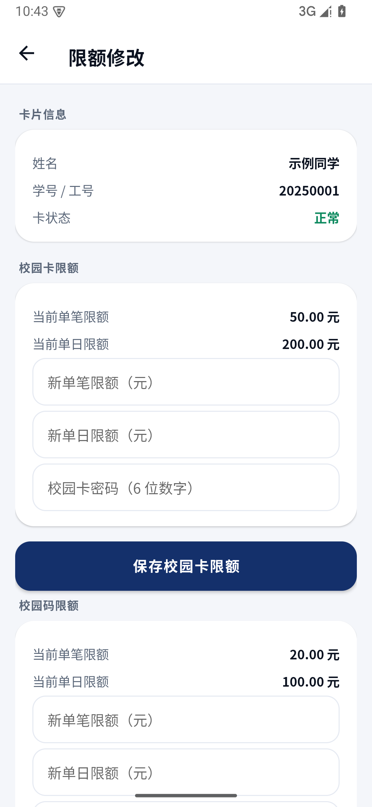

> **免责声明：本项目为非官方客户端，与北京航空航天大学及校园卡服务提供方无关。仅用于本人账号的余额、账单、流水、网费查询，以及学校官方入口跳转与本人主动发起的卡务操作（挂失、解挂、密码修改、限额修改、绑定/解绑银行卡）。所有写操作都会直接提交到学校系统，请确认后再提交；使用风险自负。**

<p align="center">
  
</p>

<h1 align="center">通财航</h1>

<p align="center">北航校园卡 Android 客户端 · 余额 / 账单 / 流水 / 网费 / 其他功能 / 充值</p>

<p align="center">
  
  
  
</p>

## 截图

| 登录 | 首页 | 账单 | 其他功能 | 限额修改 |
|---|---|---|---|---|
|  |  |  |  |  |

> 截图使用离线示例数据，不含真实姓名、学号、卡号与消费记录。

## 功能

| 模块 | 能力 |
|---|---|
| 登录 / 会话 | 统一身份认证登录、图形验证码、`CASTGC` 免密续期、启动自动恢复 |
| 首页 | 校园卡余额与状态、网费卡片（网费余额 / 剩余免费流量 / 剩余计费流量）、快捷入口、账户信息、消息通知 |
| 账单 | 当月分类消费与占比、近半年按月汇总、支出趋势；左右翻月或点月份直接选年月 |
| 流水 | 按月份 + 类型（全部 / 消费 / 充值 / 补助 / 转账）分页查询，同样支持点选年月 |
| 网费 | 原生登录校园网账号（RSA + 图形/短信验证码）；门户自动取网费余额；zfw 解析剩余免费/计费流量；充值自动打开航财通收银台 |
| 其他功能 | 校园卡挂失 / 解挂 / 密码修改 / 限额修改；绑定 / 解绑银行卡 |
| 快捷充值 | 一键打开学校官方校园卡充值页，自动带入 `JSESSIONID` 与 `CASTGC`，航财通免二次登录；支付完成自动回首页 |
| 设置 / 更新 | 会话状态、校园网登录状态、网络自检、续期、退出；应用内检查更新 |

## 安装

从 [Releases](https://github.com/y38501148-max/Buaa-SCP/releases) 下载最新的
`TongCaiHang-v*-release.apk` 安装。

或通过 USB：

```bash
./install.sh                 # 自动选择 dist/ 下的 release APK
./install.sh path/to/apk     # 指定 APK
```

release 版使用独立 keystore 签名，不能与 debug 版互相覆盖。切换签名时需要先
`adb uninstall cn.edu.buaa.scp`，本机会话会被清除。

### 从源码构建

环境：JDK 17/21、Android SDK Platform 35、Build-Tools 35.0.0。

```bash
echo "sdk.dir=$HOME/Library/Android/sdk" > local.properties
./gradlew :app:assembleDebug
./gradlew :app:testDebugUnitTest
```

debug APK 位于 `app/build/outputs/apk/debug/app-debug.apk`。仓库不含签名材料；
release 签名通过根目录 `keystore.properties` 配置。

## 校园卡充值

首页「去充值」或快捷入口「充值」会打开学校官方充值页，客户端只负责：

1. 检查会话，必要时用 `CASTGC` 续期；
2. 把 `JSESSIONID` 与 `CASTGC` 注入充值页 `WebView`；
3. 航财通跳转统一身份认证时静默完成，不再要求输密码；
4. 支付完成并回到 App 后，自动返回通财航首页。

客户端不接触支付密码、不下单、不保存银行卡或订单信息。接口与支付方式分析见
[`docs/RECHARGE.md`](docs/RECHARGE.md)。

## 网费

网费卡片需要两类数据：

- **网费余额**：来自 i北航融合门户 `it.buaa.edu.cn/home` 的「网费」指标，客户端用统一认证 `CASTGC` 自动登录门户后取得；
- **剩余免费流量 / 剩余计费流量**：来自校园网自助服务 `zfw.buaa.edu.cn/home`。校园网账号密码与统一认证密码**不同**，首次使用在 App 内的原生登录页输入一次；密码经官方登录页随机 RSA 公钥加密后只提交给 zfw，客户端不保存。登录成功后会话 Cookie 加密保存，后续自动复用；异常/风控时可回退到学校官方网页登录。

「网费充值」打开学校官方 `/pay/card` 页面；验证码、金额与支付方式都由官方页面完成。提交后官方返回的「北航手机支付」二维码，实际内容是航财通收银台地址（`cashier.cc-pay.cn`），客户端会直接解析并自动打开收银台，使用微信 H5 / 支付宝手机网站支付拉起对应 App，不需要保存图片再扫码。

详见 [`docs/NETWORK_FEE.md`](docs/NETWORK_FEE.md)。

## 其他功能与写操作

「首页 → 快捷入口 → 其他」包含六项卡务操作：

| 操作 | 说明 |
|---|---|
| 校园卡挂失 | 立即冻结卡片，需 6 位校园卡密码 |
| 校园卡解挂 | 恢复冻结卡片，需 6 位校园卡密码 |
| 密码修改 | 修改校园卡支付密码（6 位数字） |
| 限额修改 | 调整校园卡单笔 / 单日消费限额（当前线上上限 2,000 元） |
| 绑定银行卡 | 绑定或更换圈存银行卡，需输入两遍卡号 |
| 银行卡解绑 | 解除已绑定银行卡，需 6 位校园卡密码 |

安全约束：

- 校园卡密码只存在于输入框内存，提交后即丢弃；不落盘、不写日志；
- 每次提交前都有二次确认；
- 写接口失败不自动重试，避免重复提交；
- 银行卡号只提交给学校系统，本机不保存。

接口字段与安全说明见 [`docs/CARD_OPS.md`](docs/CARD_OPS.md)。

## 应用内更新

设置 → 检查更新。客户端从 GitHub Releases 获取最新版本，下载后校验 SHA-256 与
APK 签名，再交给系统安装器；启动时每天自动检查一次。受 Android 限制，安装仍需
在系统弹窗中确认一次。

## 安全与隐私

- 统一认证密码只用于 CAS 表单提交，不写入磁盘、不写日志；
- 校园网密码只用于官方 WebView 登录页，客户端不读取、不保存；
- 校园卡密码只在写操作提交时内存使用，不落盘；
- `CASTGC`、`JSESSIONID`、校园网会话均经 AndroidKeyStore AES/GCM 加密后存本机；
- 充值页与校园网 WebView 关闭文件访问与混合内容；校园卡充值退出时清除注入的会话 Cookie；
- 更新包必须与当前应用同包名、同签名，并通过 Release 中的 SHA-256 校验。

## 已知限制

- 六个卡务写接口已按官方前端协议实现，但出于安全考虑尚未在生产账号上真实提交，发布前需用低风险操作（如把限额改回原值）验证；
- 网费余额依赖门户接口；校外访问 zfw 可能受校园网限制，需连接 BUAA-WiFi 或学校 VPN；
- 验证码只支持图片类型；校方改用滑块等类型时会提示暂不支持；
- 充值依赖学校官方页面与支付渠道状态，部分账号可能显示「暂未开通」；
- 接口字段与加密方式无版本承诺，随校方发版可能变化；
- 仅在 Android 15 模拟器与 iQOO 15（Android 16）上验证。

## 文档

- [网费与充值链路](docs/NETWORK_FEE.md)
- [卡务写操作](docs/CARD_OPS.md)
- [充值接口与可行性](docs/RECHARGE.md)
- [CAS 图形验证码](docs/CAPTCHA.md)
- [验证记录](docs/VERIFICATION.md)

## 版本记录

- **0.5.0 Release 1**（2026-11-14）：首页重排为校园卡 / 网费 / 快捷入口 / 账户信息；接入门户网费余额与
  zfw 流量；校园网改为原生登录（RSA + 图形/短信验证码，网页登录兜底）；网费充值自动解析二维码并打开
  航财通收银台；新增「其他功能」承载挂失、解挂、密码修改、限额修改、绑定/解绑银行卡；删除卡务页；
  补齐官方 AES 请求信封；修复缴费时段外误判校园卡会话失效。
- **0.4.0**（2026-11-14）：全新界面与 SCP 图标；账单 / 流水支持点选年月；快捷充值支付完成自动回首页；
  应用内更新（SHA-256 + 签名校验）；移除不可用的支付渠道展示；精简登录页。
- **0.3.0**：CAS 图形验证码；官方充值页入口；运行日志隐藏；独立 keystore 的签名 release。
- **0.2.0**：真机端到端验收；修复趋势 / 消费汇总金额兜底与 edge-to-edge 遮挡。
- **0.1.0**：Kotlin 重写；CAS 登录 / 免密续期；首页、账单、流水、卡务、设置与自检。

<p align="center"><sub>非官方项目，按「现状」提供，不对数据准确性、服务可用性或任何资金操作负责。</sub></p>
