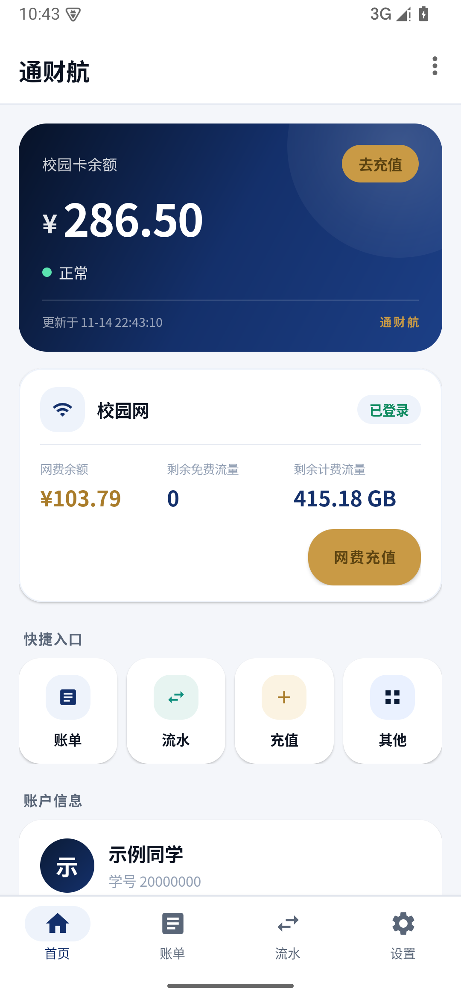
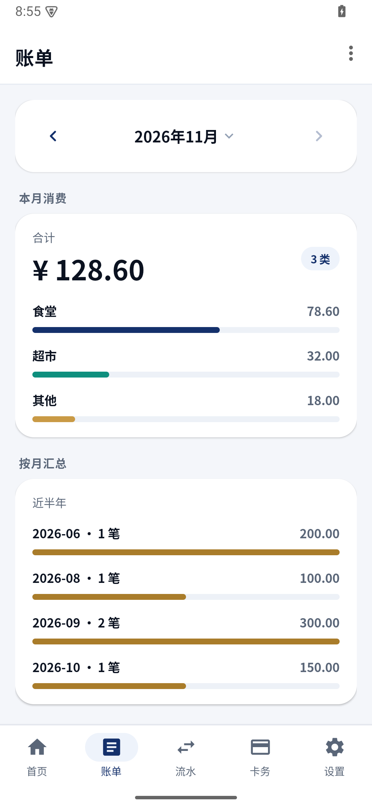
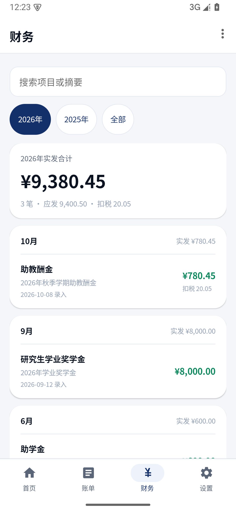
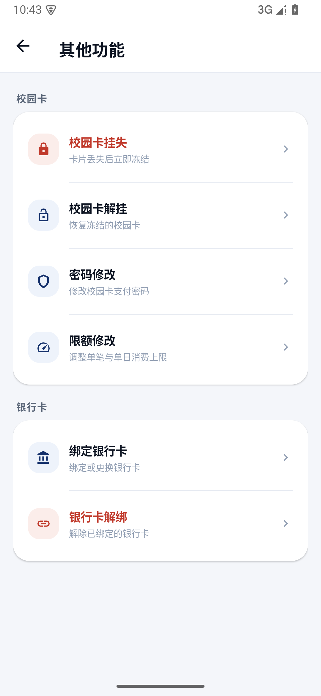
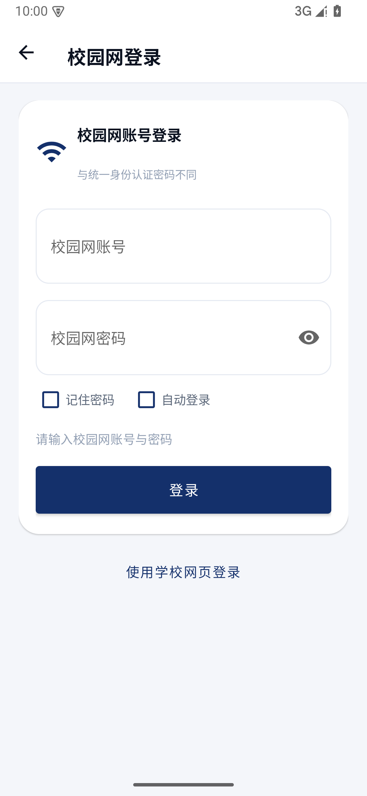

> **免责声明**：本项目为非官方客户端，与北京航空航天大学及校园卡服务提供方无关。仅用于本人账号的查询与操作；所有写操作都会直接提交到学校系统，使用风险自负。

<p align="center">
  
</p>

<h1 align="center">通财航</h1>

<p align="center">北航校园卡 Android 客户端</p>

<p align="center">
  
  
  
</p>

## 截图

| 登录 | 首页 | 账单 | 财务 |
|---|---|---|---|
|  |  |  |  |

| 其他功能 | 限额修改 | 校园网登录 |
|---|---|---|
|  |  |  |

> 截图使用离线示例数据，不含真实姓名、学号、卡号与消费记录。

## 功能

| 模块 | 能力 |
|---|---|
| 登录 / 会话 | 统一身份认证登录、图形验证码、`CASTGC` 免密续期；可选「记住密码 / 自动登录」 |
| 首页 | 支付二维码（每 15 秒自动刷新，点击刷新）、扫一扫、校园卡余额、网费、快捷入口与消息通知 |
| 账单 | 月度消费 / 充值合计、分类与近半年趋势；类型筛选、分页明细、按月切换 |
| 财务 | 学校财务系统个人收入：年度筛选、实发合计、按月分组、搜索与详情 |
| 网费 | 校园网原生登录（RSA + 图形/短信验证码）、余额与剩余流量、跳转官方充值 |
| 卡务 | 校园卡挂失 / 解挂 / 密码修改 / 限额修改；绑定 / 解绑银行卡 |
| 充值 | 打开学校官方充值页并注入当前会话，支付完成自动回首页 |
| 更新 | GitHub Release 检查更新，校验 SHA-256 与签名后交给系统安装 |

## 安装

从 [Releases](https://github.com/y38501148-max/Buaa-SCP/releases) 下载最新的
`TongCaiHang-v*-release.apk`。也可通过 USB 安装：

```bash
./install.sh                 # 自动选择 dist/ 下的 release APK
./install.sh path/to/apk     # 指定 APK
```

release 与 debug 版签名不同，不能互相覆盖；切换前需
`adb uninstall cn.edu.buaa.scp`（会清除本机会话）。

### 从源码构建

环境：JDK 17/21、Android SDK Platform 35、Build-Tools 35.0.0。

```bash
echo "sdk.dir=$HOME/Library/Android/sdk" > local.properties
./gradlew :app:assembleDebug
./gradlew :app:testDebugUnitTest
```

debug APK 位于 `app/build/outputs/apk/debug/app-debug.apk`。仓库不含签名材料，
release 签名通过根目录 `keystore.properties` 配置。

## 文档

- [支付二维码与扫一扫](docs/PAYMENT_QR.md)
- [网费与充值链路](docs/NETWORK_FEE.md)
- [卡务写操作](docs/CARD_OPS.md)
- [账单与流水](docs/BILLING.md)
- [财务收入查询](docs/FINANCE.md)
- [充值接口与可行性](docs/RECHARGE.md)
- [CAS 图形验证码](docs/CAPTCHA.md)
- [登录、会话持久化与自动登录](docs/LOGIN.md)
- [验证记录](docs/VERIFICATION.md)

## 安全说明

- 密码默认不保存；开启「记住密码」后经 AndroidKeyStore AES/GCM 加密存于本机，关闭开关或退出登录即清除；
- `CASTGC`、`JSESSIONID`、校园网会话同样加密保存；
- 校园卡密码只在提交写操作时于内存使用，不落盘、不写日志；写操作需二次确认，失败不自动重试；
- 更新包必须与当前应用同包名、同签名，并通过 Release 中的 SHA-256 校验。

## 已知限制

- 验证码仅支持图片类型；图形 / 短信 / 账号锁定等场景可能降级为手动登录；
- 网费流量依赖校园网自助服务，校外访问可能需要 BUAA-WiFi 或学校 VPN；
- 接口与加密方式随校方发版可能变化；
- 仅在 Android 15 模拟器与 iQOO 15（Android 16）上验证。

## 版本记录

| 版本 | 主要变更 |
|---|---|
| 0.8.1 | 修复付款码与扫码后续确认、身份初始化和查询参数路由；无效码可重扫，首页允许截图 |
| 0.8.0 | 首页支付二维码与扫一扫；二维码 15 秒自动刷新，余额合并入卡片 |
| 0.7.0 | 会话持久化：记住密码 / 自动登录，学号默认记住 |
| 0.6.0 | 账单与流水合并；新增财务收入查询 |
| 0.5.0 | 门户网费、校园网原生登录、卡务写操作 |
| 0.4.0 | 全新界面、应用内更新（SHA-256 + 签名校验） |
| 0.1.0–0.3.0 | Kotlin 重写、CAS 登录与免密续期、图形验证码、官方充值入口 |

<p align="center"><sub>非官方项目，按「现状」提供，不对数据准确性、服务可用性或任何资金操作负责。</sub></p>
