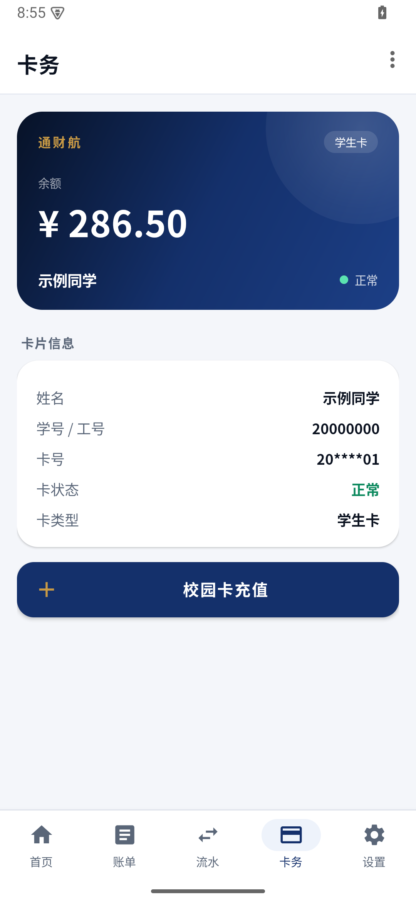

> **免责声明：本项目为非官方客户端，与北京航空航天大学及校园卡服务提供方无关。仅用于本人账号的余额、账单、流水、卡务查询与学校官方充值入口跳转；不提供支付下单、挂失、补卡等写操作。使用风险自负。**

<p align="center">
  
</p>

<h1 align="center">通财航</h1>

<p align="center">北航校园卡 Android 客户端 · 余额 / 账单 / 流水 / 卡务 / 快捷充值</p>

<p align="center">
  
  
  
</p>

## 截图

| 登录 | 首页 | 账单 | 卡务 |
|---|---|---|---|
|  |  |  |  |

> 截图使用离线示例数据，不含真实姓名、学号、卡号与消费记录。

## 功能

| 模块 | 能力 |
|---|---|
| 登录 / 会话 | 统一身份认证登录、图形验证码、`CASTGC` 免密续期、启动自动恢复 |
| 首页 | 余额、卡状态、账户信息、消息通知、账单 / 流水 / 卡务 / 充值快捷入口 |
| 账单 | 当月分类消费与占比、近半年按月汇总、支出趋势；左右翻月或点月份直接选年月 |
| 流水 | 按月份 + 类型（全部 / 消费 / 充值 / 补助 / 转账）分页查询，同样支持点选年月 |
| 卡务 | 卡片信息、状态、余额与官方充值入口 |
| 快捷充值 | 一键打开学校官方充值页，自动带入 `JSESSIONID` 与 `CASTGC`，航财通免二次登录；支付完成自动回首页 |
| 设置 / 更新 | 会话状态、网络自检、续期、退出；应用内检查更新 |

## 安装

从 [Releases](https://github.com/y38501148-max/Buaa-SCP/releases) 下载最新的
`TongCaiHang-v*-release.apk` 安装。

或通过 USB：

```bash
./install.sh                 # 自动选择 dist/ 下的 release APK
./install.sh path/to.apk     # 指定 APK
```

release 版使用独立 keystore 签名，不能与 debug 版互相覆盖。切换签名时需要先
`adb uninstall cn.edu.buaa.scp`，本机会话会被清除。

### 从源码构建

环境：JDK 17/21、Android SDK Platform 35、Build-Tools 35.0.0。

```bash
echo "sdk.dir=$HOME/Library/Android/sdk" > local.properties
./gradlew :app:assembleDebug
./gradlew :app:testDebugUnitTest
```

debug APK 位于 `app/build/outputs/apk/debug/app-debug.apk`。仓库不含签名材料；
release 签名通过根目录 `keystore.properties` 配置。

## 快捷充值

首页「去充值」或卡务页「校园卡充值」会打开学校官方充值页，客户端只负责：

1. 检查会话，必要时用 `CASTGC` 续期；
2. 把 `JSESSIONID` 与 `CASTGC` 注入充值页 `WebView`；
3. 航财通跳转统一认证时静默完成，不再要求输密码；
4. 支付完成并回到 App 后，自动返回通财航首页。

客户端不接触支付密码、不下单、不保存银行卡或订单信息。接口与支付方式分析见
[`docs/RECHARGE.md`](docs/RECHARGE.md)。

## 应用内更新

设置 → 检查更新。客户端从 GitHub Releases 获取最新版本，下载后校验 SHA-256 与
APK 签名，再交给系统安装器；启动时每天自动检查一次。受 Android 限制，安装仍需
在系统弹窗中确认一次。

## 安全与隐私

- 密码只用于 CAS 表单提交，不写入磁盘、不写日志；
- `CASTGC` 等同登录凭据，经 AndroidKeyStore AES/GCM 加密后存本机；
- 充值页使用独立 WebView，关闭文件访问与混合内容，退出时清除注入的会话 Cookie；
- 更新包必须与当前应用同包名、同签名，并通过 Release 中的 SHA-256 校验。

## 已知限制

- 验证码只支持图片类型；校方改用滑块等类型时会提示暂不支持；
- 充值依赖学校官方页面与支付渠道状态，部分账号可能显示「暂未开通」；
- 接口字段与加密方式无版本承诺，随校方发版可能变化；
- 仅在 Android 15 模拟器与 iQOO 15（Android 16）上验证。

## 文档

- [充值接口与可行性](docs/RECHARGE.md)
- [CAS 图形验证码](docs/CAPTCHA.md)
- [验证记录](docs/VERIFICATION.md)

## 版本记录

- **0.4.0**（2026-11-14）：全新界面与 SCP 图标；账单 / 流水支持点选年月；快捷充值支付完成自动回首页；
  应用内更新（SHA-256 + 签名校验）；移除不可用的支付渠道展示；精简登录页。
- **0.3.0**：CAS 图形验证码；官方充值页入口；运行日志隐藏；独立 keystore 的签名 release。
- **0.2.0**：真机端到端验收；修复趋势 / 消费汇总金额兜底与 edge-to-edge 遮挡。
- **0.1.0**：Kotlin 重写；CAS 登录 / 免密续期；首页、账单、流水、卡务、设置与自检。

<p align="center"><sub>非官方项目，按「现状」提供，不对数据准确性、服务可用性或任何资金操作负责。</sub></p>
